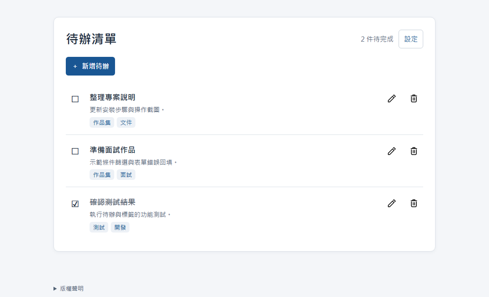

# Laravel Todo List

以 Laravel、Blade 和 MySQL 建立的待辦清單，使用 Docker Sail 在本機執行。



## v1.1 的改動

- 延續 v1.0 的新增、編輯、刪除與完成切換。新增區可收合，分頁草稿會保留到成功送出。編輯驗證失敗時，原列會保持展開並顯示中文提示。
- 一筆待辦可有多個標籤，以半形逗號、全形逗號或頓號分隔。點標籤即可篩選，點「×」回到全部。
- 刪除前可取消，操作成功後顯示 5 秒提示。設定可調整字級與主題色，瀏覽器會記住選擇。

[查看 v1.0 原版畫面](public/screenshots/todo-list.png)

## 從 v1.0 升級

1. 在原專案目錄更新至 v1.1。沿用原有 `.env`、專案名稱及 MySQL 資料卷。若要用新版預設網址，在 `.env` 設定 `APP_PORT=8080` 和 `APP_URL=http://127.0.0.1:8080`。
2. 執行以下指令。新增的 migration 建立 `todo_tags` 表，既有待辦會保留，初始沒有標籤。

```bash
./vendor/bin/sail up -d
./vendor/bin/sail artisan migrate
```

網頁與 MySQL 綁定本機位址。若從主機端連線 MySQL，新版預設埠為 `13306`，可用 `FORWARD_DB_PORT` 調整。容器間仍使用 `mysql:3306`。

## 首次安裝

在已啟用 Docker 整合的 WSL Ubuntu 執行以下指令。

```bash
git clone https://github.com/June2803/laravel-todo-list.git
cd laravel-todo-list
cp -n .env.example .env
docker run --rm -u "$(id -u):$(id -g)" -v "$PWD:/var/www/html" -w /var/www/html laravelsail/php84-composer:latest composer install
```

在新建的 `.env` 設定本機 MySQL 密碼，再啟動服務與初始化資料表。

```bash
./vendor/bin/sail up -d
if grep -qx 'APP_KEY=' .env; then
    ./vendor/bin/sail artisan key:generate
fi
./vendor/bin/sail artisan migrate
```

## 日常使用與測試

- 啟動用 `./vendor/bin/sail up -d`，停止用 `./vendor/bin/sail stop`。使用範例設定時，開啟 [本機待辦清單](http://127.0.0.1:8080/)。
- 執行 `./vendor/bin/sail artisan test`。PHPUnit 使用記憶體 SQLite，涵蓋待辦操作、表單驗證、標籤篩選與刪除關聯。
- 手動驗收可新增一筆帶有「面試，重要」的待辦，點其中一個標籤，再按「×」。編輯時將標題改成三個空格，確認該列顯示提示並保留說明。

## 程式位置

- `routes/web.php` 與 `app/Http/Controllers/TodoController.php` 處理請求、驗證與儲存。
- `app/Models/` 與 `database/migrations/` 定義待辦、標籤及兩者的關聯。
- `resources/views/todos/`、`public/css/todo.css` 與 `public/js/` 負責畫面、互動及外觀偏好。

## 圖示來源

- [鉛筆圖示，由 Ilham Fitrotul Hayat 製作](https://www.flaticon.com/free-icons/pencil)
- [刪除圖示，由 Ilham Fitrotul Hayat 製作](https://www.flaticon.com/free-icons/delete)
